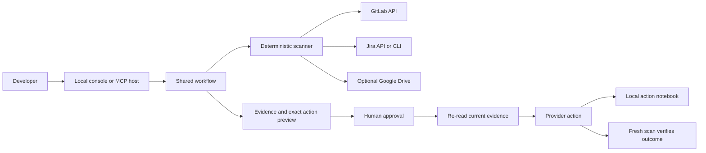

# ProjectSync

**Find where GitLab and Jira disagree. Inspect the evidence. Approve and verify a repair.**

A local developer tool and MCP server for a focused workflow: a merge request is merged, but its linked ticket is still in progress; the latest pipeline failed without a visible tracking reference; review or release documentation has fallen behind.

ProjectSync is not connected to Glean and does not call an LLM itself. An MCP host such as Kiro supplies conversational reasoning. The server supplies deterministic checks, source evidence, and controlled provider actions. The browser console also works without an AI subscription.

## Teammate handoff: clone, configure, and demo

### 1. Get the code and check the sample workflow

Install **Node.js 22 or 24**, npm, and **Python 3**. Python is only needed for the full test/build suite, not to run the app. Commands below assume macOS/Linux or Windows WSL.

```bash
git clone https://github.com/BlizzardPurple/chhotabheem.git
cd chhotabheem
git switch main
npm ci
npm test
npm run hackathon -- --check
npm run hackathon
```

For an existing checkout on `main`, use `git pull --ff-only origin main` before `npm ci` instead of cloning again. Keep your local `.env`; it is ignored by git.

Open the **actual URL printed in the terminal**, normally `http://127.0.0.1:3031`. The launcher tries nearby ports if its default is busy. `PORT` in `.env` or an explicit `--port` is respected; choose another port if that one is occupied:

```bash
npm run hackathon -- --port 3032
```

The badge must say **SYNTHETIC SAMPLE**. Click **Scan project** to get five findings. Open the first finding's evidence, select **Review action**, then **Approve simulated action**. The fresh scan should show four findings and one resolution. **Activity log** shows the action; **Reset sample** restores the scenario. No external providers are contacted in this mode. Stop the server with **Ctrl+C** before changing modes.

### 2. Configure the live demo using your existing access

If `.env` does not exist yet, copy `.env.example` to `.env`. Do not overwrite a configured file:

```bash
cp .env.example .env
```

Edit `.env` locally. Replace every `YOUR_...` placeholder; this example reuses an authenticated `glab` and `ankitpokhrel/jira-cli` installation:

```dotenv
GITLAB_PROJECT=YOUR_GROUP/YOUR_SUBGROUP/YOUR_DEMO_REPO
GITLAB_HOST=https://YOUR_GITLAB_HOST
JIRA_PROJECT=YOUR_JIRA_PROJECT_KEY
JIRA_URL=https://YOUR_JIRA_HOST
JIRA_TRANSPORT=cli
JIRA_DONE_STATUS=Done
PORT=3031
```

Use `https://gitlab.com` for the public GitLab service. `GITLAB_PROJECT` is the full namespace/path or numeric project ID, not a website URL. `JIRA_DONE_STATUS` must be a valid target in your team's workflow. Jira CLI uses its own configured server; confirm that it matches `JIRA_URL`.

Verify the existing logins from the **same terminal and OS user** that will launch the app:

```bash
glab auth status --hostname YOUR_GITLAB_HOSTNAME
jira me
npm run doctor
```

Use just the hostname, for example `gitlab.com`, in the `glab` command. Leave `GITLAB_TOKEN` unset to reuse glab. Keep any `JIRA_API_TOKEN` already required by your Jira CLI; `JIRA_TRANSPORT=cli` ensures it stays on that path. Never activate placeholder tokens or commit real credentials.

If the provider CLIs are unavailable, the app also supports GitLab tokens, Jira Cloud email/API tokens, and Jira Server/Data Center bearer tokens. Follow the exact alternatives in [SETUP.md](SETUP.md#2-reuse-configured-access-or-use-api-tokens). Google Drive is optional; missing access appears as an incomplete check. Fix failed GitLab/Jira checks before presenting. The doctor performs reads only and does not prove write permissions.

### 3. Start and rehearse the live workflow

```bash
npm run hackathon:live
```

Open the printed URL and confirm **LIVE INTEGRATIONS**. Live mode never switches silently to sample data.

Prepare one authorized sandbox story before judging:

1. Create a Jira ticket with clear acceptance criteria and leave it **In Progress**.
2. Merge a small MR **within the last seven days**, with that exact Jira key in its branch name, title, or description.
3. Confirm the work satisfies your team's Done criteria; a merge alone is not sufficient.
4. Scan the project, inspect both source records, and preview the exact transition.
5. Approve it, refresh Jira, and inspect the new scan and activity log. If optional checks are incomplete, show the refreshed Jira status and explain the partial coverage.

Rehearse this once, then manually restore only the sandbox ticket to its starting state. Do not reset real work. Run one live process at a time: approval caches are process-local, and the browser and MCP server are separate processes.

For a port conflict, use `npm run hackathon:live -- --port 3032`. For provider auth, VPN/TLS, Jira validators, and other failures, see [troubleshooting](SETUP.md#troubleshooting).

### 4. Present the product and connect the AI host

The console's **Presentation** link opens `/pitch`: five slides, arrow-key navigation, speaker notes, and print/PDF support. **Export evidence** downloads a report labeled with its live/sample mode and source coverage.

For the AI portion, connect Kiro or your stdio MCP host using the absolute-path configuration in [SETUP.md](SETUP.md#6-connect-to-kiro-or-another-stdio-mcp-host). Ask it to scan, explain the evidence, preview a repair, wait for your approval, then rescan. **`npm start` runs the MCP server, not the browser console**; use `npm run hackathon` or `npm run hackathon:live` for the browser.

[Four-minute demo script](docs/DEMO.md) · [Submission text](docs/SUBMISSION.md) · [Engineering Q&A](docs/ENGINEERING.md)

### 5. Build or share an offline deliverable

```bash
npm run deliverable
```

This runs the tests, rehearses all five sample actions through a temporary local HTTP server, and creates `dist/projectsync-hackathon.tar.gz`, its SHA-256 checksum, and `dist/rehearsal.json`. The archive includes JavaScript dependencies and a file manifest; real `.env` files, credentials, and local notebooks are excluded.

**`dist/` and `node_modules/` are generated and are not committed.** A fresh clone must run `npm ci`; build the archive with the command above or obtain the prepared bundle separately. PDF/video artifacts are included only if already generated locally; this build command does not create a browser recording. The HTML slide deck is always included.

On another machine with Node.js installed, extract the archive, enter `projectsync-hackathon/`, and run:

```bash
node scripts/hackathon.mjs
```

No package download is needed for the bundled synthetic demo. See [START-HERE.md](START-HERE.md) for the offline handoff. AWS is optional after the local live rehearsal succeeds; [deployment and teardown](docs/AWS.md) are documented separately.

## What is implemented

| Check | Evidence | Available action |
|---|---|---|
| Merged MR, linked ticket still open | Explicit Jira key, merge timestamp, Jira status category | Preview and approve a configured Jira transition; a merge alone does not imply Done |
| Latest default-branch pipeline failed | Current pipeline, failed job, bounded log excerpt, Jira text lookup | Preview and approve a linked bug in the configured Jira project |
| Old MR with incomplete approval | MR age and approval API | Prepare a review summary; does not send a notification or resolve the review |
| No project release-notes document found | Seven-day merge window and project-qualified Drive search | Preview and approve a Google Doc from merge summaries |
| Recent branch with commits, no open MR | Actual default branch, branch comparison, MR list | Preview and approve a draft MR |

The MCP tools are `scan`, `reconcile`, `repo_status`, `get_sync_log`, `session_diff`, and `jira_to_mr`. The last tool can prepare a branch and open a draft MR once commits exist, after reviewing a separate approval plan. It does not change Jira status automatically.

## End-to-end flow



The browser triggers the final scan automatically; with MCP, ask the assistant to scan again. Evidence from APIs and job logs is untrusted content, not permission to act. Every external write requires a reviewed proposal and an approval token. Tokens expire after five minutes; changed scans or payloads require a new preview. Replaying a completed token returns its result in the same running process. This is not a distributed exactly-once guarantee.

Local notebooks live in `~/.projectsync/` or `PROJECTSYNC_HOME`. They contain scan findings and reconciliation action records; protect that directory like other work data. The separate `jira_to_mr` convenience workflow is not recorded in this notebook. The legacy S3 adapter is excluded from the supported live path.

## What to show the judges

1. Open a live merged MR and its still-open sandbox Jira ticket.
2. Scan, show both pieces of evidence, and explain why the discrepancy is a review candidate.
3. Preview the exact transition and approve it after confirming the team's Done criteria.
4. Show the updated Jira ticket, the fresh scan, and the activity log.
5. Show Kiro explaining the evidence through MCP, plus one tested failure case.

[Demo script and Q&A](docs/DEMO.md) · [Judge's audit](docs/AUDIT.md) · [Engineering decisions](docs/ENGINEERING.md) · [Optional AWS deployment](docs/AWS.md)

## Verification and limits

`npm test` exercises rules, adapter contracts, approval/retry/failure boundaries, HTTP behavior, MCP transport, and deployment packaging without live accounts. `npm run doctor` performs read-only checks against configured sources; it cannot certify write permissions or Jira workflow validators. Rehearse an approved sandbox write on the presenting machine before judging.

No semantic matching, built-in root-cause model, notifications, deployed AWS service, or production identity system is claimed. Scan scope and source failures are returned explicitly. An absence of findings means none were detected within that scope.

AWS artifacts are prepared for a **read-only public synthetic console** on Lambda + HTTP API. The local live workflow is the priority. Do not put real provider tokens into the public demo template. See [AWS steps and teardown](docs/AWS.md) after the local demo succeeds.

`SCOPE.md`, `DESIGN.md`, and `TASKS.md` are historical plans. This README and the current runbooks describe the implementation.
