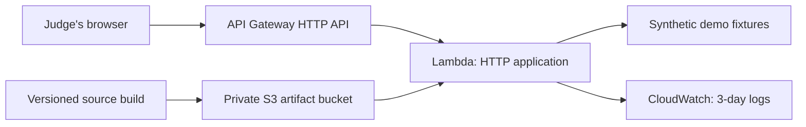

# Optional AWS demo deployment

The priority is the complete local demo on the machine that already has GitLab and Jira authentication. AWS is an optional second delivery target. These artifacts have not been deployed: this checkout's environment has no AWS CLI, profile, or AWS credential environment variables. Existing authentication on your other machine is separate from this environment.

The cloud target serves **synthetic, read-only scan and action-preview data** over HTTPS. The full local demo supports approval and execution. Hosting real company data, a remote MCP endpoint, and shared execution state require additional work and are not claimed here.

## Architecture and reasoning



CloudFormation defines the infrastructure; `scripts/aws.py` packages and manages it. The HTTP application is shared with the local server, and `deploy/lambda.mjs` translates AWS events into Web Requests. This keeps business logic independent of hosting. The adapter uses the documented [HTTP API payload format v2](https://docs.aws.amazon.com/apigateway/latest/developerguide/http-api-develop-integrations-lambda.html).

The function uses [Node.js 24 on Lambda](https://docs.aws.amazon.com/lambda/latest/dg/lambda-nodejs.html), arm64, 256 MB memory, and a 10-second timeout. Its IAM role can write only its own logs. No database, NAT gateway, EC2 instance, Bedrock calls, or provider credentials are part of this deployment. Demo write endpoints are disabled with `PROJECTSYNC_PUBLIC_DEMO=true`. Lambda instances do not provide a durable shared notebook; the local MCP runtime remains the complete workflow.

## Inspect and package offline

Run from the repository root:

```bash
npm ci
npm test
python3 scripts/aws.py plan
python3 scripts/aws.py package
```

The zip and SHA-256 manifest appear in ignored `dist/aws/`. Packaging explicitly selects application files and dependencies, excluding local environment files, notebooks, CLI credentials, and Git history. Repeating the package command with unchanged inputs yields the same hash. CloudFormation updates reference the content hash, so application changes trigger a deployment update.

The deployment regression tests run with `node --test deploy/*.test.mjs`; they verify payload decoding, duplicate queries, cookies, binary responses, request limits, the public-mode guard, reproducible packaging, and credential exclusion. A built zip has also been extracted into a fresh temporary directory and exercised through the Lambda adapter: assets, health, synthetic scan, preview, and blocked execution passed. AWS has not validated the templates yet; after authentication, run `aws cloudformation validate-template --template-body file://deploy/template.json --profile hackathon --region us-east-1` and the same for `deploy/artifacts.json` before deployment.

## Deploy later, after the local walkthrough works

1. Install [AWS CLI v2 using AWS's platform instructions](https://docs.aws.amazon.com/cli/latest/userguide/getting-started-install.html) on the deployment machine.
2. Configure a named `hackathon` profile using your account's supported sign-in method. Keep credentials in the AWS CLI credential store; do not paste them into chat or source files.
3. Use `aws sts get-caller-identity --profile hackathon` to identify the burner account. The lifecycle script requires that exact account ID and refuses a mismatch.
4. Add a small AWS Budget alert in the account, then execute the prepared deployment. The deployment identity needs CloudFormation, S3, Lambda, IAM role creation/pass-role, CloudWatch Logs, and API Gateway permissions. The runtime role is far narrower.

```bash
python3 scripts/aws.py deploy --profile hackathon --region us-east-1 --account-id YOUR_12_DIGIT_ACCOUNT_ID
```

This is a mutating command: it creates two stacks, uploads the packaged source, and prints `DemoUrl`. The URL is public, with synthetic data only. It is a browser demo; pointing Kiro at this URL does not create a remote MCP connection. Use the existing stdio MCP entry point for Kiro on the authenticated local machine.

Open `DemoUrl`, run a scan, inspect evidence, and preview a proposed action. Verify that approval/execution are unavailable in public mode. To inspect deployment status:

```bash
python3 scripts/aws.py status --profile hackathon --region us-east-1 --account-id YOUR_12_DIGIT_ACCOUNT_ID
```

## Cost and cleanup

The default region is `us-east-1` to make the example pricing explicit. At published first-tier rates, 10,000 API requests cost approximately **$0.01** for HTTP API calls. Assuming 256 MB and 200 ms per invocation, Lambda compute is approximately **$0.0067**, plus **$0.002** in request fees, before any credits/free tier. These are estimates; S3, logs, network transfer, cold starts, and actual duration are additional. See [API Gateway pricing](https://aws.amazon.com/api-gateway/pricing/) and [Lambda pricing](https://aws.amazon.com/lambda/pricing/).

HTTP API targets 5 requests/second with burst 10. AWS describes throttling as [best effort, not a guaranteed ceiling](https://docs.aws.amazon.com/apigateway/latest/developerguide/http-api-throttling.html). Neither throttling nor budget alerts guarantee a spending cap. Do not leave a public hackathon endpoint running indefinitely. Logs expire after 3 days and build artifacts after 7 days; keep source locally so an expired deployment package can be rebuilt/reuploaded.

After the event, remove both stacks and their uploaded build files:

```bash
python3 scripts/aws.py destroy --profile hackathon --region us-east-1 --account-id YOUR_12_DIGIT_ACCOUNT_ID
```

`destroy` removes only the bucket obtained from this project's artifact stack and the associated demo stack. It removes the demo logs too. Download any demo evidence you want to keep before cleanup.

## Optional container

The provided Dockerfile packages the same public read-only demo; AWS Lambda deployment does not require Docker. Docker needs `public/` assets and the HTTP server implementation in place.

```bash
docker build -t projectsync-demo .
docker run --rm -p 3000:3000 projectsync-demo
```

For live provider integrations, continue using the local MCP server and the machine's existing CLI authentication. The container deliberately does not copy those credentials.
