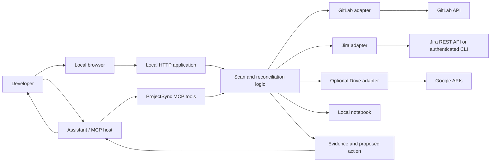

# Engineering decisions you can defend

The useful MTS-1 story is: “We found assumptions that could make the tool confidently wrong, then made those assumptions visible and testable.” Name the failure, explain the smallest fix, and show the test or behavior that supports it.

## End-to-end mental model

The MCP host understands the user's language and chooses tools. ProjectSync fetches provider data, runs explicit checks, and returns findings. Reconciliation turns a selected finding into a reviewable action. In that main workflow, the provider adapter performs an approved write and the notebook records the intent and result. These are separate responsibilities; the presence of an AI host does not make the detector itself a language model.

The local browser can use live provider adapters on the authenticated user's machine. Synthetic provider state is a separate rehearsal mode that makes the same product story reproducible without company credentials. AWS hosting is a later delivery option, separate from the local stdio MCP server. Stdio is a child-process protocol, not a public HTTP endpoint.

The shared workflow in `src/workflow.js` sits behind the entry points. It stores the last scan, creates an action preview, and issues a random approval token bound to the project, scan, and action payload. An approval expires after five minutes. Applying it requires the approval flag, the original token, and an unchanged action payload rebuilt from a fresh scan. The branch-MR payload includes the expected source commit SHA. A scan change invalidates an unexecuted preview. Completed tokens return their prior result in the same process; an execution with an uncertain outcome is not silently retried. These checks reduce avoidable mistakes, but they are not a replacement for identity, authorization, or durable coordination in a shared deployment.

The separate `jira_to_mr` convenience tool has its own preview/approval flow in `src/tools/jira-to-mr.js`. It prepares a branch and, once there are actual changes, a draft MR. It leaves Jira status unchanged. Its operations are not recorded in the shared scan/reconcile notebook; the tool result and provider records are the evidence for this convenience path.

## Decisions and tradeoffs

| Decision | Practical justification | Cost or limit |
|---|---|---|
| Keep a small JavaScript application | Existing code already uses native modules, `fetch`, and the MCP SDK. Improving correctness is more valuable in this timebox than a language migration. | Runtime validation and tests carry more of the contract than TypeScript types would. |
| Separate adapters from rules | Provider auth, HTTP/CLI details, and domain checks can change independently. Tests can use controlled data without network calls. | Extra interfaces must stay small; generic provider frameworks would be premature. |
| Deterministic detection, assistant explanation | Whether an MR is merged or a ticket has a done status should be grounded in data. An assistant can explain evidence and help draft text. | Exact-key linking misses ambiguous relationships. A model-based guess should be a suggestion, never proof for an automatic write. |
| Preview before changing another system | Users can inspect the target and proposed result before approval. | One extra interaction, justified by the cost of an incorrect ticket transition or duplicate bug. |
| Revalidate before apply | GitLab/Jira may change while a user reviews the proposal. | Another read costs latency; it prevents acting on stale observations. |
| Make partial coverage explicit | “Could not read Jira” and “found no Jira mismatch” are different outcomes. | Reports need coverage metadata and the UI must explain it. |
| Bound network requests and scans | A slow provider should not hang a demo or produce unbounded work. | A bounded scan cannot claim exhaustive historical coverage. |
| Use a repeatable synthetic scenario | Every teammate and judge can reproduce both a success and a failure without credentials or external writes. | It is not evidence that live provider authentication or permissions have been tested. |
| Keep an action history | A user can explain why a write happened and what the provider returned. | A local notebook is not a tamper-proof enterprise audit system or shared database. |
| Test meaningful boundaries | Counterexamples and failure cases catch confident-but-wrong behavior. | Passing unit tests does not replace sandbox integration testing. |
| Use infrastructure as code for a cloud demo | Reviewable resources and teardown make a burner account repeatable. | Cloud deployment still requires a real authenticated account and successful smoke test. |

These are principles applied to concrete defects, not a list of patterns added for appearance. A modular monolith is sufficient here. The next database or queue should be introduced when durable multi-user state or asynchronous work actually requires it.

## Questions a reviewer will ask

**“Where is the AI?”** The MCP host can interpret the request, explain the returned evidence, and help compose a proposal. The server's explicit mismatch checks are ordinary code. The browser fixture demo does not prove a Bedrock or Glean model call. Show the assistant invocation if demonstrating AI, and identify which text it generated.

**“Why not just write a script?”** The deterministic core is intentionally script-like. The product value comes from packaging a repeated cross-system task as evidence, a reviewed action, verification, and history inside the developer's workflow. Prove the reduction in manual steps rather than asserting that wrapping APIs is inherently novel.

**“Why not use Glean?”** Glean can provide enterprise context and actions. This project explores a specific GitLab/Jira reconciliation policy with transparent rules and tests. It could complement a knowledge platform; claiming broad feature superiority would not be supported.

**“Can merged work automatically become Done?”** No universal workflow permits that assumption. An MR may be one part of a ticket, may not be deployed, or may still require QA. Present it as a review candidate and require the owner to approve the actual target state.

**“Does a green scan mean everything is correct?”** No. It means no configured rule found a mismatch in the successfully examined scope. Missing source access and scan limits must remain visible.

**“Why does the diff say unverified after Jira was updated?”** The aggregate diff requires all checks to complete before declaring missing findings resolved. If Drive or another check is unavailable, it conservatively keeps those findings unverified across scans. The confirmed Jira response and refreshed ticket can establish the specific transition, while the overall scan remains partial. This is an intentionally conservative simplification; per-rule verification is a possible later improvement.

**“Is this exactly-once processing?”** Do not make that claim. Reusing a completed approval token returns the stored result within the same process. Pending actions for a project are serialized in that process, and some actions check whether their target already exists. A restart loses the approval cache. A provider may accept a write before a network timeout, and concurrent workers need durable coordination. Exactly-once cross-service effects are not established by an in-memory cache.

**“What happens if a write succeeds but logging fails?”** The application must not describe the provider write as rolled back. Report the confirmed write and the history failure separately; investigate before retrying. A multi-provider workflow needs step-by-step outcomes rather than an implied transaction.

**“What if the verification scan fails after a successful write?”** The console retains the successful action result and reports verification separately. The next step is to inspect or rescan the provider state, not blindly repeat the write.

**“Why AWS?”** Hosting the demonstration gives judges a shareable URL and exercises deployment, logging, and lifecycle management. AWS is an infrastructure choice here. Adding Bedrock would be a separate, scoped model integration with explicit costs and evaluation.

**“What would you build next?”** First run an approved sandbox integration test and validate workflow assumptions with a small team. Then add authenticated shared state, durable action coordination, and a measured explanation-generation experiment. Broader connectors follow evidence of demand.

## How to talk about learning

Use a concrete example: “Our first implementation interpreted a failed Jira lookup as an empty result. That could tell a user everything was fine when we had no evidence. We separated source availability from findings and added a test for the outage case.”

Then explain one tradeoff: “We kept exact-key matching because it is explainable. Semantic matching may find more relationships, but we would display confidence and ask for confirmation before using those relationships to change another system.”

Finish with a boundary: “We have a reproducible demo and automated tests. We still need organization-specific workflow validation and durable shared-state guarantees before a team-wide deployment.” This demonstrates engineering judgment without pretending the prototype is enterprise-ready.
